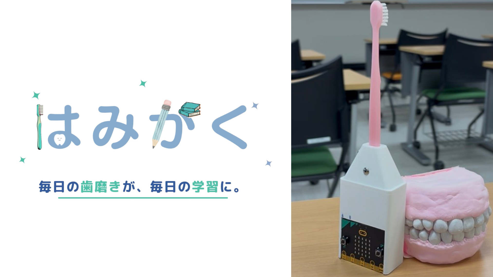
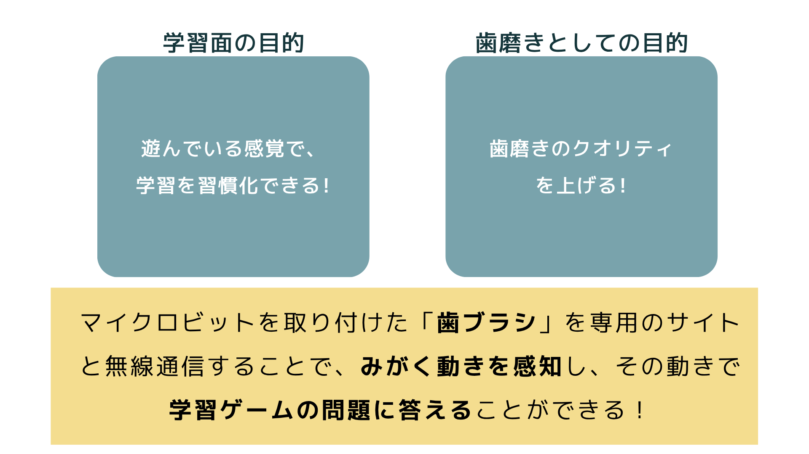
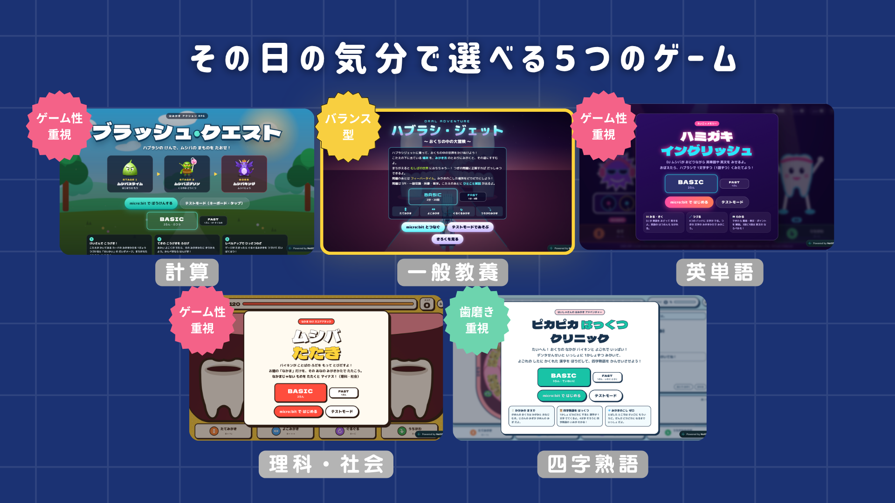
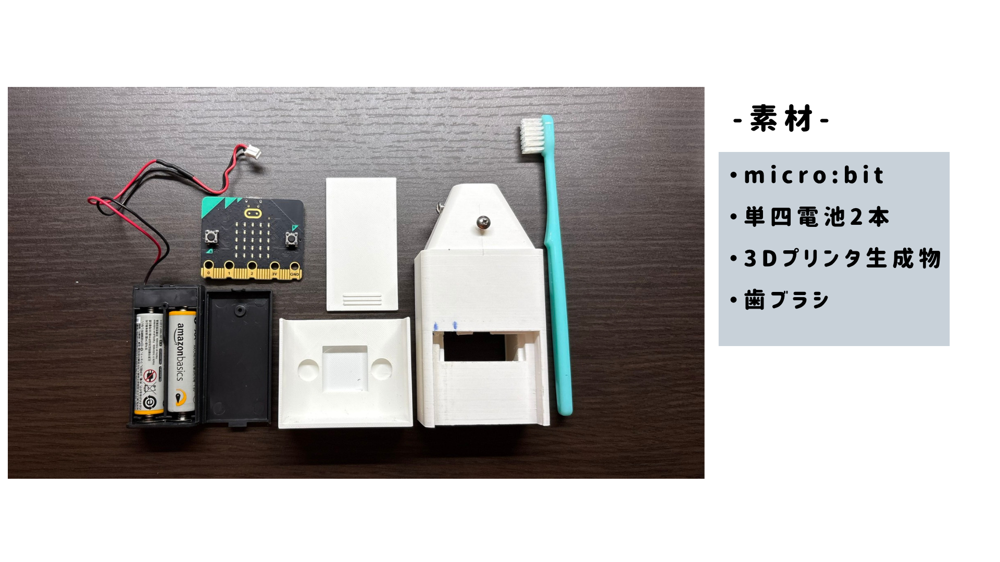

# はみがく 〜歯を磨いて学習を習慣化せよ〜



micro:bit を取り付けた歯ブラシと専用のサイトを無線でつなぎ、**磨く動きでゲームの問題に答える** しくみです。
ゲームのような感覚で学習でき、毎日の歯みがきの時間を使って **学習の習慣化** をサポートします。

- **遊べるサイト：https://hamigaku-game.netlify.app**
- ProtoPedia：[はみがく〜歯を磨いて学習を習慣化せよ〜](https://protopedia.net/prototype/9998)
- ステータス：開発中

## 目的



- **学習面**：遊んでいる感覚で、学習を習慣化できる
- **歯磨きとして**：歯磨きのクオリティを上げる（磨く場所と磨き方を案内し、まんべんなく磨けるようにする）

## しくみ

```
歯ブラシ ＋ micro:bit（3Dプリンタで作ったホルダー）
   │  加速度センサーで「磨き方」を判定
   │  Bluetooth で番号を送る：0=たて 1=よこ 2=ぐるぐる 3=うちがわ
   ▼
ブラウザのゲーム（Chrome：パソコン / Android スマホ）
   │  磨き方で問題に答える
   │  その磨き方を、画面に出した「磨く場所」の時間として記録
   ▼
正解・不正解を micro:bit に送りかえす（O / X を LED に表示）
```

- micro:bit は磨き方を番号にして送るだけで、場所の案内・時間の記録・正解の判定はゲーム側で行います
- micro:bit では **場所** はわからないので、ゲームが「ここを、この磨き方で磨こう」と口の図と文字で案内します
- 磨く場所と順番は、歯科の資料にある12か所（上下 × そとがわ・うちがわ × 左・前・右）をもとにしています
- 1回は **2分（BASIC）** または **1分（FAST）**。学習しているうちに、12か所をまんべんなく磨き終わるように時間を配分しています

## ゲーム



その日の気分で選べる5つのゲームがあります。[遊べるサイト](https://hamigaku-game.netlify.app) から選べます。HTML ファイルをブラウザで直接開いても動きます。

| ファイル | ゲーム | 磨き方ですること | 学べること |
|---|---|---|---|
| [mainapp.html](mainapp.html) | ハブラシ・ジェット | 口の中を冒険し、2択クイズの答えの道を、指定された場所と磨き方で磨いて選ぶ。まちがえると「むしばの世界」へ | SPI・一般常識・時事・雑学（正解数に合わせて3段階の難しさ） |
| [rpg.html](rpg.html) | ブラッシュ・クエスト | 磨いて敵をこうげき。弱点の磨き方で大ダメージ | 計算 |
| [haiishasan.html](haiishasan.html) | ピカピカ はっくつ クリニック | デンタせんせいと1か所ずつ磨き、よごれの下にかくれた漢字をほりだす | 四字熟語 |
| [dance.html](dance.html) | ハミガキ イングリッシュ | DJ ムシバのダンスで見せた英単語・英文を、磨き方で1文字（1語）ずつ組み立てる | 英単語・英文と発音 |
| [tataki.html](tataki.html) | ムシバ たたき | お題の「なかま」のことばを持ったバイキンだけを、その穴の磨き方でたたく | 理科・社会のなかま分け |

### 遊び方

1. **Google Chrome**（パソコン、または Android スマホ）で https://hamigaku-game.netlify.app を開いて、ゲームを選ぶ
2. 「micro:bit で はじめる」を押して、micro:bit を選んでつなぐ（Web Bluetooth API を使います）
3. 画面の案内どおりに磨いて、問題に答える

micro:bit がなくても **テストモード** でキーボードを使って試せます。

| 磨き方 | キー |
|---|---|
| ↕ たてみがき | ↑ ↓ |
| ↔ よこみがき | ← → |
| ↻ ぐるぐるみがき | C |
| ⤵ うちがわみがき | G |

## micro:bit のプログラム

[microbit/main.ts](microbit/main.ts)（MakeCode の JavaScript）

- 歯ブラシは横向き（持ち手が水平）で持つ前提です
- 加速度の変化から、たて・よこ・ぐるぐるを、ブラシの向き（Z軸）から内側磨きを判定し、番号を Bluetooth UART で送ります
- ゲームから届いた `O` / `X` を LED に表示します

## 材料



- micro:bit
- 単四電池2本（電池ボックス）
- 3Dプリンタで作ったホルダー
- 歯ブラシ

## 3Dモデル

[3d-models/microbit-holder/](3d-models/microbit-holder/) に、歯ブラシに micro:bit をとりつけるホルダーのデータがあります。

| ファイル | 中身 |
|---|---|
| `holder_body.stl` | 本体（電池ボックス内蔵） |
| `holder_lid.stl` | 背面のスライドふた |
| `holder_cover.stl` | micro:bit の防水カバー |
| `holder.py` | 上の3つを作るプログラム。寸法を変えて作り直せる |

## 開発に使ったもの

| 種類 | 使ったもの |
|---|---|
| デバイス | micro:bit |
| API・言語 | Web Bluetooth API、HTML、CSS、JavaScript |
| ツール | MakeCode、3Dプリンタ、Android スマホ |

## くわしい資料

- [磨く場所・磨き方・ゲージのしくみ](docs/brushing-gauge.md)：メインゲームで、どこをどの磨き方で何秒磨くか、磨いた時間をどう記録するか
